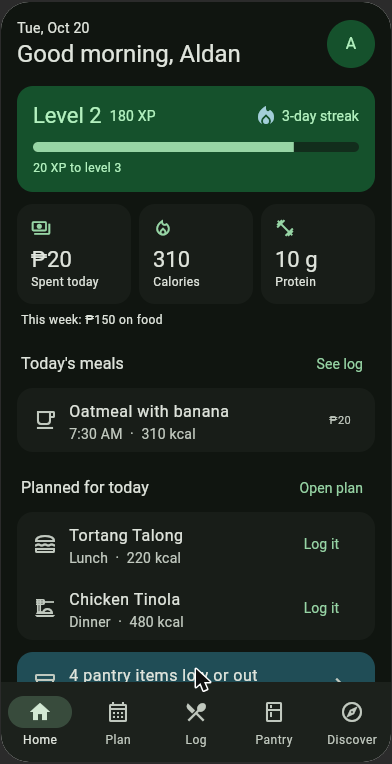
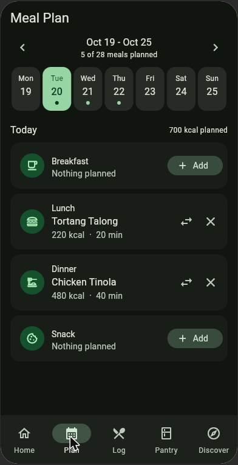
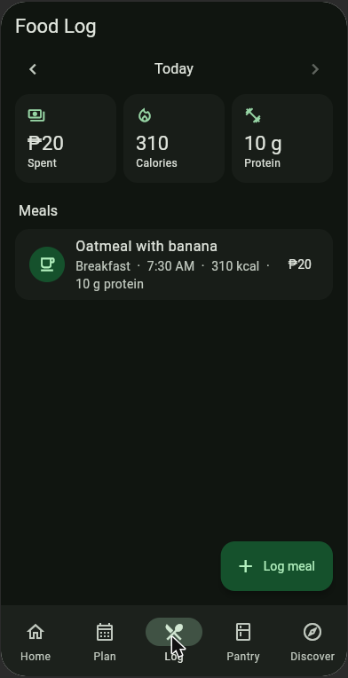
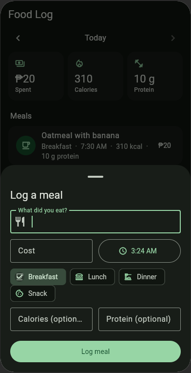
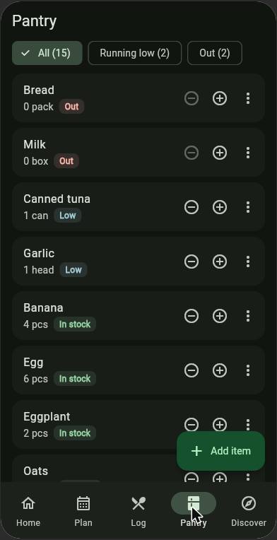
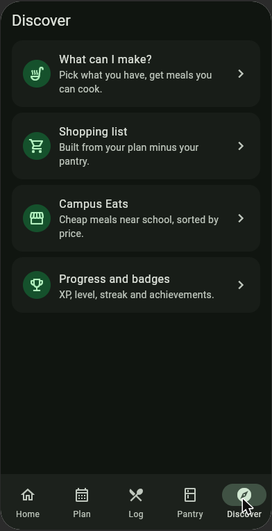
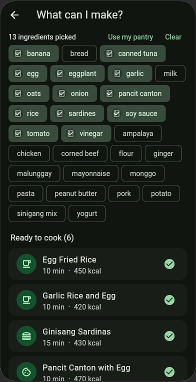
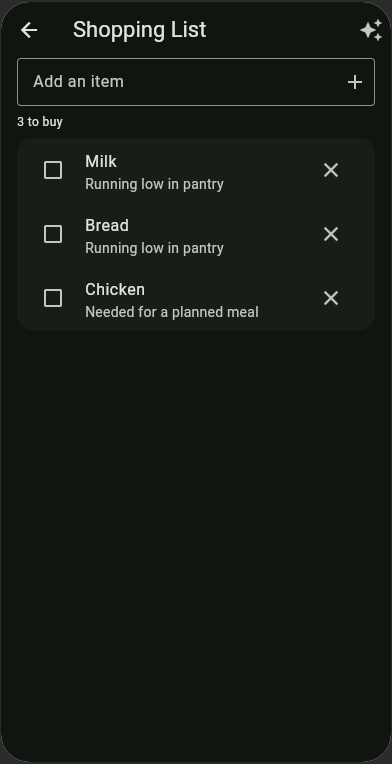
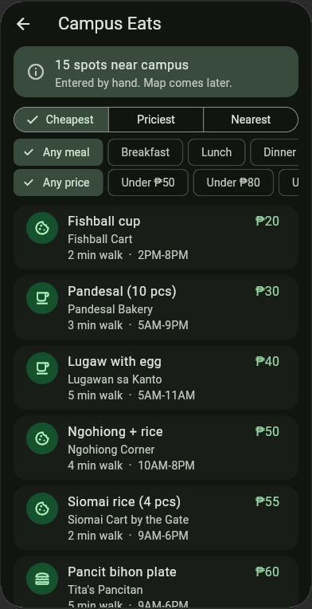
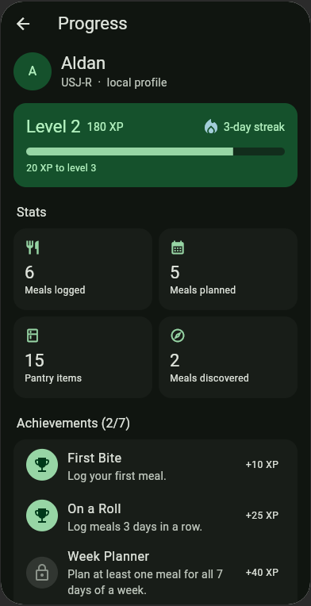

# NutriTrack

All-in-one food and healthy lifestyle app for students: plan meals, log what you eat, manage your pantry, find meals you can cook with what you have, build a shopping list, discover cheap food around campus, and earn XP for keeping it up.

Built with **Flutter** using the **MVVM** pattern. 2026 Apps Dev 1 project.

> **Checkpoint 1 status:** UI prototype, Flutter UI for every feature, navigation and MVVM structure are done. Data is sample data held in memory (no database or login yet). Calories and protein are estimates for awareness, not medical advice.

## Screens

| Home | Meal Plan | Food Log | Log a meal | Pantry |
|---|---|---|---|---|
|  |  |  |  |  |

| Discover | What can I make? | Shopping List | Campus Eats | Progress |
|---|---|---|---|---|
|  |  |  |  |  |

## Features

| Feature | What it does now |
|---|---|
| Dashboard | Greeting by name, level/XP/streak, today's spend, calories and protein, today's meals, today's plan, pantry alerts, quick actions |
| Meal plan | Week view, breakfast/lunch/dinner/snack slots per day, pick from 20 recipes, swap or remove |
| Food log | Log a meal (name, cost, time, type, optional calories/protein), edit, swipe to delete with undo, move between days |
| Pantry | Add items with quantity and unit, +/- stock, In stock / Low / Out status, filters, send to shopping list |
| What can I make? | Pick ingredients (defaults to your pantry), see meals ready to cook and meals missing 1-2 items, add missing items to the list, log it |
| Shopping list | Add items, one tap builds the list from your plan minus your pantry plus low stock, "Done shopping" moves items into the pantry |
| Campus Eats | 15 hand-entered spots near campus, sort by cheapest/priciest/nearest, filter by meal type and budget |
| Progress | Level, XP, streak, stats, 7 achievements |

**XP rules:** log a meal +10 · plan a meal +5 · pantry update +2 · check a shopping item +3 · finish a list +15 · discover a meal +8. Every 100 XP is a level.

## Architecture (MVVM)

```
View (widgets)  ──watches──▶  ViewModel (ChangeNotifier)  ──calls──▶  Repository (Model)
     ▲                               │                                     │
     └──────── rebuilds ◀── notifyListeners ◀──────── notifyListeners ◀────┘
```

- **Model** — `lib/models/` holds plain data classes. `lib/data/nutri_repository.dart` is the single source of truth: it stores the data, applies XP and achievements, and notifies listeners on every change.
- **ViewModel** — `lib/viewmodels/`, one per feature. It reads from the repository, exposes ready-to-show values (totals, filters, sorted lists, labels) and the actions the screen can take. No widgets in here.
- **View** — `lib/views/`, one folder per feature. Views only read view model state with `context.watch` and call view model methods. No business logic.
- **Services** — `lib/services/gamification_service.dart` holds pure level and streak math.

Providers are wired in `lib/app.dart` with the `provider` package. Replacing the sample data with local storage or an API later only changes `NutriRepository`.

```
lib/
├── main.dart                 # entry point
├── app.dart                  # providers, theme, routes
├── core/                     # routes, theme, formatters, icons
├── models/                   # Recipe, FoodLogEntry, PantryItem, PlannedMeal, ShoppingItem, CampusSpot, Achievement, UserProfile
├── data/                     # NutriRepository + sample data
├── services/                 # GamificationService (XP, levels, streaks)
├── viewmodels/               # one ViewModel per feature + ShellViewModel
├── views/                    # shell, home, plan, log, pantry, discover, shopping, campus, progress
└── widgets/                  # shared UI pieces (XpCard, StatTile, EmptyState, SectionHeader)
```

## Navigation

```
MainShell (bottom NavigationBar, IndexedStack keeps each tab's state)
├── Home        → Progress, What can I make?, Shopping list, Campus Eats (named routes)
├── Plan
├── Log         → Log-a-meal bottom sheet
├── Pantry      → Add item dialog
└── Discover    → What can I make? · Shopping list · Campus Eats · Progress
```

Named routes live in `lib/core/app_routes.dart`. `ShellViewModel` holds the selected tab so any screen can switch tabs (for example, the dashboard's "See log" button).

## Run it

Requires Flutter 3.38+.

```bash
flutter pub get
flutter run            # pick a device: Android emulator, Chrome, or Windows
flutter test           # widget + unit tests
```

## Team

Kanban board: 2026AppsDev1 - NutriTrack (KanbanFlow).
